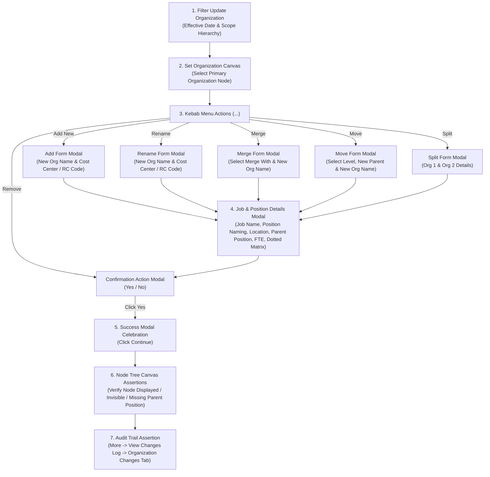

# Documentation: Business Flow 1 - Set Organization

Dokumen ini berisi panduan dan acuan resmi untuk **Business Flow 1: Set Organization** pada modul **My Organization -> Manage Organization**.

---

## 1. Overview & Goal

**Set Organization (Flow 1)** adalah alur bisnis utama tempat pengguna (HR / Org Administrator) melakukan penyesuaian dan rekayasa hirarki struktur organisasi pada aplikasi. Transaksi dilakukan pada tampilan kanvas interaktif (*Organization Tree Canvas*) dan menghasilkan pencatatan audit log otomatis pada **Changes Log (Tab: Organization Changes)**.

---

## 2. End-to-End Workflow Diagram

---

## 3. Step-by-Step Business Process

### Fase 1: Inisiasi & Filter Scope
1. User masuk ke modul **My Organization** -> **Manage Organization**.
2. Klik tombol **Update Organization**.
3. Di modal/halaman **Update Organization (Filter)**:
   - Memilih **Effective Date** (tanggal berlakunya perubahan struktur baru).
   - Memilih scope hirarki organisasi yang ingin disesuaikan (**Directorate**, **Sub Directorate**, **Group**, **Division**, atau **Department**).
   - Klik **Next** untuk me-load kanvas pohon organisasi.

### Fase 2: Pemilihan Node Organisasi & Aksi Kebab Menu
1. Pada kanvas pohon organisasi (*Set Organization Canvas*), user memilih node organisasi sasaran (`primaryOrganization`).
2. Klik **Kebab Button (`...`)** pada node tersebut untuk membuka dropdown aksi menu (`OrgMenuAction`).

### Fase 3: Pengisian Form Informasi Umum Organisasi (Step 1)
User mengisi form sesuai dengan jenis aksi yang dipilih (nama organisasi baru, RC Code, organisasi penggabung, level baru, atau parent baru).

### Fase 4: Penetapan Detail Job & Position (Step 2)
Untuk aksi yang memerlukan pembuatan/penyesuaian jabatan (*Add New*, *Rename*, *Merge*, *Move*, *Split*):
- **Job Section**: Memilih **Job Name** (melalui searchable dropdown).
- **Position Section**:
  - Memilih **Position Naming Type** (misal *Area of Responsibility +*).
  - Memilih **Location** (misal *Kantor Pusat - Menara Asia*).
  - Memilih **Parent Position Name** (jabatan atasan langsung).
  - Mengisi **FTE (Full Time Equivalent)**.
  - Menentukan flag **Dotted Matrix** (jika Add New).
  - *(Khusus Split: mengisi tab Organization 1 dan tab Organization 2)*.

### Fase 5: Konfirmasi & Selebrasi Sukses
1. **Confirmation Action Modal**: Menampilkan dialog konfirmasi (*"Are you sure you want to Add/Rename/Merge/Move/Split/Remove...?"*). User klik **Yes**.
2. **Success Modal**: Pop-up sukses selebrasi muncul (*Added*, *Renamed*, *Merged*, *Moved*, *Split*, atau *Removed*). User klik **Continue**.

### Fase 6: Validasi Kanvas & Audit Trail (Changes Log)
1. **Verifikasi Node Tree**: Memastikan node organisasi baru/hasil perataan tampil di kanvas pohon organisasi, dan node lama yang digabung/dihapus disesuaikan keberadaannya.
2. **Verifikasi Audit Log (Changes Log)**: Membuka tombol **More** -> **View Changes Log** -> tab **Organization Changes** untuk memvalidasi pencatatan log transaksi dinamis secara tepat.

---

## 4. Matriks Aturan Bisnis Aksi (Business Rules Matrix)

Tabel berikut menjadi acuan resmi perilaku sub-organisasi (*child org*), indikator posisi, dan teks audit log untuk masing-masing dari 6 aksi:

| Jenis Aksi (*Action*) | Perlakuan Terhadap Sub-Organisasi (*Child Org*) | Status Tag Position pada Tree Canvas | Pola Kalimat Audit Log di Changes Log |
| :--- | :--- | :--- | :--- |
| **1. Add New / Add Sub-ordinate** | Membuat child org baru di bawah node terpilih. | *Normal* (Mengatur job/position baru untuk org baru). | `You created new sub-ordinate organization, {newOrgName} from {parentOrgName} from the organization structure` |
| **2. Rename** | Sub-org di bawahnya **tetap ada** (tidak terhapus). | Berubah menjadi tag **"Missing Parent Position"** (karena posisi parent di-rename). | `You Renamed {oldOrgName} to {newOrgName} from the organization structure` |
| **3. Merge** | Sub-org di bawah kedua/seluruh organisasi yang di-merge **akan terhapus**. | Posisi dan sub-org lama hilang, digantikan oleh struktur org baru hasil merge. | `You merged '{primaryOrg}', '{mergeWithOrg}', and '{newMergeOrg}' from the organization structure` |
| **4. Move** | Sub-org di bawahnya **tetap ada** (ikut berpindah). | Berubah menjadi tag **"Missing Parent Position"** (karena parent berpindah lokasi/level). | `You moved {primaryOrg} to {newOrgName}` |
| **5. Split** | • **Organization 1**: Mewarisi sub-org di bawahnya. • **Organization 2**: Tidak memiliki sub-org (kosong). | Sub-org pada Organization 1 mendapat tag **"Missing Parent Position"**. | `You Split '{primaryOrg}' into '{splitOrg1}' and '{splitOrg2}' from organization structure` |
| **6. Remove** | Organisasi sasaran **beserta seluruh sub-org di bawahnya ikut terhapus**. | Seluruh node & posisi dalam cabang tersebut dihapus dari hirarki. | `You removed {removedOrgName} from the organization structure` |

---

## 5. Pemetaan Komponen Selenium Java

### Page Object & Enum Classes
- `FilterUpdateOrganizationPage.java`: Menangani inisiasi filter tanggal & hierarki.
- `SetOrganizationPage.java`: Menangani interaksi node pohon organisasi & kebab menu.
- `OrgMenuAction.java`: Enum pilihan menu aksi kebab (`ADD_NEW`, `RENAME`, `MOVE`, `MERGE`, `SPLIT`, `REMOVE`, `EXPAND`).
- `ConfirmAction.java`: Enum konfirmasi transaksi (`ADD`, `RENAME`, `MOVE`, `MERGE`, `SPLIT`, `REMOVE`) yang memetakan nama aksi modal konfirmasi dan teks status selebrasi sukses (*past-tense*).
- `AddFormModal.java`, `RenameFormModal.java`, `MergeFormModal.java`, `MoveFormModal.java`, `SplitFormModal.java`: Menangani form langkah 1 per aksi.
- `AddJobPositionModal.java`, `JobSectionComponent.java`, `PositionSectionComponent.java`: Menangani form langkah 2 detail jabatan.
- `ConfirmationActionModal.java`: Menangani konfirmasi persetujuan transaksi.
- `SuccessModal.java`: Menangani pop-up selebrasi hasil transaksi.
- `ChangesLogModal.java`: Menangani pencarian dan validasi log transaksi dinamis pada tab *Organization Changes*.

### Helper & Test Classes Mapping
- **Helper**: 
  - `SetOrganizationHelper.java` (Orkestrasi alur antar modal, form, penanganan konfirmasi berbasis `ConfirmAction`, dan validasi log).
  - `AssignEmployeeHelper.java` (Orkestrasi alur penugasan karyawan dan konfirmasi transaksi perataan organisasi pendukung).
- **Positive Test Cases**:
  - `AddOrganizationTest.java` (`addNewOrganizationTest`)
  - `RenameOrganizationTest.java` (`renameOrganizationTest`)
  - `MergeOrganizationTest.java` (`mergeOrganizationTest`)
  - `MoveOrganizationTest.java` (`moveOrganizationTest`)
  - `SplitOrganizationTest.java` (`splitOrganizationTest`)
  - `RemoveOrganizationTest.java` (`removeExistingOrganizationTest` & `removeNewOrganizationTest`)

---

## 6. Prasyarat & Best Practice Testing

1. **Isolation Execution**:
   Setiap method test dijalankan secara **terisolasi (*isolated execution*)**, sehingga saat modal *Changes Log* dibuka dalam satu eksekusi test, log yang diperiksa merupakan log transaksi tunggal milik test tersebut.
2. **Dynamic Assertions**:
   Pengecekan teks log di dalam `ChangesLogModal` menggunakan pencocokan kata kunci dinamis (*Action Title* + *Nama-nama Organisasi Dinamis*) dari data test Excel (`OrganizationTestData`), bukan hardcoded string.
3. **In-Line Validation**:
   Validasi *Node Tree Canvas* dan *Changes Log* disatukan di akhir test method happy path yang sama untuk mengoptimalkan durasi eksekusi suite test (efisiensi Waktu & Resource).
