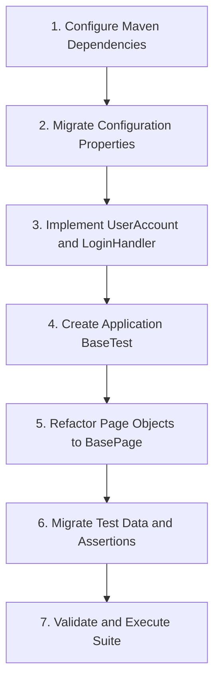

# Migration Guide: Migrating Legacy Projects to Framework-Core

This comprehensive guide explains the practical steps to migrate legacy monolithic Selenium test suites to a modular architecture powered by `framework-core`.

---

## Why Migrate?

| Aspect | Monolithic Legacy Automation Project | With Framework-Core |
|---|---|---|
| **Project Structure** | All tests, page objects, drivers, and configuration are mixed in a single `src/` directory. | Clean multi-module architecture: `framework-core` (reusable library) and application test modules. |
| **Driver & Thread Safety** | Drivers are initialized manually or statically, causing race conditions in parallel execution. | `DriverManager` uses `ThreadLocal`, providing full thread safety out of the box. |
| **Authentication & Login** | Login steps are hardcoded in base tests or global helpers. | Pluggable authentication using `LoginHandler` and `UserAccount` interfaces. |
| **Configuration Management** | Scattered across `System.getProperty` calls without standardized fallbacks. | Cascading configuration: System Properties -> Environment Variables -> `.env` -> `application-{env}.properties` -> `framework.properties`. |
| **Reporting & Diagnostics** | Basic static reports without network request capture. | Interactive 3-Tab ExtentReports with auto-screenshots and CDP network error capture (4xx/5xx). |
| **Modern UI Components** | Difficult handling of Shadow DOM, Radix UI dropdowns, or complex tables. | Built-in `DropdownComponent`, `WebTable`, and automatic JavaScript click fallbacks. |

---

## Migration Steps



---

### Step 1: Add the `framework-core` Dependency

In your test application's `pom.xml`, add `framework-core` as a dependency:

```xml
<dependencies>
    <!-- Framework Core Library -->
    <dependency>
        <groupId>com.automation.framework</groupId>
        <artifactId>framework-core</artifactId>
        <version>1.0.0</version>
    </dependency>
</dependencies>
```

---

### Step 2: Migrate Configuration to `application.properties`

Move hardcoded URLs, timeouts, and execution settings into `src/test/resources/application.properties`:

```properties
# Target Web Application
base.url=https://staging.example.com
timeout.default=15

# Browser Configuration (Overridable via CLI)
browser=chrome
headless=true

# Developer Mode (Optional)
devMode=false
devPort=9222
```

For multi-environment configurations (such as staging vs. production), create environment-specific files:
* `application-staging.properties`
* `application-production.properties`

Activate an environment profile using the JVM parameter `-Denv=staging` or the environment variable `AUTOMATION_ENV=staging`.

---

### Step 3: Abstract Accounts and Authentication

#### 3.1. Create a User Model (`UserAccount`)
Implement the `UserAccount` interface for your application users:

```java
package com.mycompany.app.model;

import com.automation.framework.core.account.UserAccount;
import lombok.AllArgsConstructor;
import lombok.Getter;

@Getter
@AllArgsConstructor
public class AppUser implements UserAccount {
    private String username;
    private String password;
    private String role;
}
```

#### 3.2. Implement an Application-Specific `LoginHandler`
Implement the `LoginHandler` interface to isolate login steps from test classes:

```java
package com.mycompany.app.auth;

import com.automation.framework.core.account.UserAccount;
import com.automation.framework.core.auth.LoginHandler;
import org.openqa.selenium.By;
import org.openqa.selenium.WebDriver;

public class AppLoginHandler implements LoginHandler {

    private final By usernameField = By.id("user-name");
    private final By passwordField = By.id("password");
    private final By loginButton = By.id("login-button");
    private final By dashboardHeader = By.cssSelector(".title");

    @Override
    public void login(WebDriver driver, UserAccount account) {
        driver.findElement(usernameField).sendKeys(account.getUsername());
        driver.findElement(passwordField).sendKeys(account.getPassword());
        driver.findElement(loginButton).click();
    }

    @Override
    public boolean isLoggedIn(WebDriver driver) {
        return !driver.findElements(dashboardHeader).isEmpty();
    }

    @Override
    public void logout(WebDriver driver) {
        // Application logout logic
    }
}
```

---

### Step 4: Create Your Application `BaseTest`

Create an abstract base test in your module that extends `com.automation.framework.core.test.BaseTest`:

```java
package com.mycompany.app.base;

import com.automation.framework.core.auth.LoginHandler;
import com.automation.framework.core.config.FrameworkConfig;
import com.automation.framework.core.test.BaseTest;
import com.mycompany.app.auth.AppLoginHandler;

public abstract class AppBaseTest extends BaseTest {

    private final AppLoginHandler loginHandler = new AppLoginHandler();

    @Override
    protected String getUrl() {
        return FrameworkConfig.get("base.url", "https://staging.example.com");
    }

    @Override
    protected LoginHandler getLoginHandler() {
        return loginHandler;
    }
}
```

> [!NOTE]
> `BaseTest` automatically manages driver initialization, ExtentReports creation, TestNG listener lifecycle, failure screenshot capture, and `ThreadLocal` session cleanup.

---

### Step 5: Refactor Page Objects to `BasePage`

Update existing Page Object classes to inherit from `com.automation.framework.core.page.BasePage`.

#### Before (Legacy Monolithic Pattern):
```java
// LEGACY CODE
public class LoginPage {
    private WebDriver driver;
    public LoginPage(WebDriver driver) { this.driver = driver; }

    public void enterUsername(String user) {
        Thread.sleep(2000); // Flaky and hardcoded
        driver.findElement(By.id("username")).sendKeys(user);
    }
}
```

#### After (Framework-Core Pattern):
```java
// MODERN CODE
package com.mycompany.app.pages;

import com.automation.framework.core.page.BasePage;
import org.openqa.selenium.By;
import org.openqa.selenium.WebDriver;

public class LoginPage extends BasePage {

    private final By usernameInput = By.id("username");
    private final By loginBtn = By.id("login-button");

    public LoginPage(WebDriver driver) {
        super(driver);
    }

    public void enterUsername(String username) {
        // Built-in explicit wait from BasePage
        typeText(usernameInput, username);
    }

    public void clickLogin() {
        // Smart click with automatic JavaScript fallback
        click(loginBtn);
    }
}
```

---

### Step 6: Migrate Assertions and Test Data

#### 6.1. Use `CustomAssert` and `CustomSoftAssert`
Replace standard TestNG assertions with `CustomAssert` to automatically log failures and attach screenshots to reports:

```java
import com.automation.framework.core.assertion.CustomAssert;

// Automatically captures screenshot on failure and attaches it to ExtentReports
CustomAssert.assertEquals(actualTitle, "Dashboard", "Dashboard title did not match expectation");
```

#### 6.2. Use `JsonDataReader` or `ExcelDataReader`
Use built-in data readers to decouple test logic from static test values:

```java
import com.automation.framework.core.data.JsonDataReader;
import com.automation.framework.core.data.ResourcePathResolver;

// Read data/users.json into AppUser model objects
List<AppUser> users = JsonDataReader.readList(
    ResourcePathResolver.resolve("data/users.json"), 
    AppUser.class
);
```

---

### Step 7: Execution and Validation

Run your test suite with Maven Surefire:

```bash
# Run headless in CI pipeline
mvn clean test -Dheadless=true

# Run for a specific environment
mvn clean test -Denv=staging

# Run with a specific browser
mvn clean test -Dbrowser=firefox
```

After execution finishes, open the interactive report at:
```text
reports/index.html
```

---

## Post-Migration Checklist

- [ ] Redundant third-party dependencies have been removed from `pom.xml`.
- [ ] Direct `Thread.sleep()` calls have been replaced with explicit wait methods from `BasePage`.
- [ ] `WebDriver` access in all test classes uses `DriverManager.getDriver()` without static driver fields.
- [ ] The generated `reports/index.html` report displays test execution steps and the Network Logs tab.
- [ ] The CI/CD pipeline (`.github/workflows/ci.yml` or Jenkins) successfully completes a headless test run.
