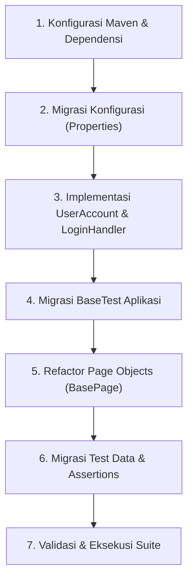

# 🔄 Migration Guide: Migrating Legacy Projects to Framework-Core

Panduan komprehensif ini menjelaskan langkah-langkah praktis untuk memigrasikan suite pengujian Selenium monolitik (legacy) ke arsitektur modular berbasis **Framework-Core**.

---

## 📌 Mengapa Migrasi?

| Aspek | Proyek Otomasi Monolitik (Legacy) | Dengan Framework-Core |
|---|---|---|
| **Struktur Proyek** | Seluruh test, page object, driver, dan config tercampur dalam 1 modul `src/`. | Multi-module bersih: `framework-core` (reusable library) dan project module aplikasi. |
| **Driver & Thread Safety** | Driver diinisiasi manual atau static, rawan tabrakan saat parallel execution. | `DriverManager` berbasis `ThreadLocal`, 100% thread-safe out-of-the-box. |
| **Otentikasi / Login** | Hardcoded di base test atau helper global. | Pluggable via interface `LoginHandler` dan `UserAccount`. |
| **Manajemen Konfigurasi** | Tersebar di `System.getProperty` tanpa fallback yang terstandarisasi. | Cascading config: SysProp &rarr; Env &rarr; `.env` &rarr; `application-{env}.properties` &rarr; `framework.properties`. |
| **Pelaporan & Diagnosa** | Laporan statis sederhana tanpa network capture. | Interaktif 3-Tab ExtentReports + auto screenshot + CDP network error capture (4xx/5xx). |
| **Aksesibilitas & UI Modern** | Sulit menangani Shadow DOM, Radix UI, atau Web Table kompleks. | Komponen bawaan `DropdownComponent`, `WebTable`, dan automatic JS click fallback. |

---

## 🚀 Langkah-Langkah Migrasi



---

### Langkah 1: Tambahkan Dependensi `framework-core`

Pada `pom.xml` modul aplikasi pengujian Anda, jadikan `framework-core` sebagai dependensi:

```xml
<dependencies>
    <!-- Framework Core Library -->
    <dependency>
        <groupId>com.automation.framework</groupId>
        <artifactId>framework-core</artifactId>
        <version>1.0.0</version>
    </dependency>
</dependencies>
```

---

### Langkah 2: Migrasi Konfigurasi ke `application.properties`

Pindahkan seluruh URL, timeout, dan kredensial yang sebelumnya di-hardcode ke `src/test/resources/application.properties`:

```properties
# Target Web Application
base.url=https://staging.example.com
timeout.default=15

# Browser Configuration (Bisa di-override via CLI)
browser=chrome
headless=true

# Developer Mode (Opsional)
devMode=false
devPort=9222
```

Untuk multi-environment (misalnya staging vs production), buat:
* `application-staging.properties`
* `application-production.properties`

Aktifkan profil dengan parameter JVM `-Denv=staging` atau environment variable `AUTOMATION_ENV=staging`.

---

### Langkah 3: Abstraksi Akun & Otentikasi

#### 3.1. Buat Model Akun (`UserAccount`)
Implementasikan interface `UserAccount` untuk entitas pengguna aplikasi Anda:

```java
package com.mycompany.app.model;

import com.automation.framework.core.account.UserAccount;
import lombok.AllArgsConstructor;
import lombok.Getter;

@Getter
@AllArgsConstructor
public class AppUser implements UserAccount {
    private String username;
    private String password;
    private String role;
}
```

#### 3.2. Buat `LoginHandler` Spesifik Aplikasi
Implementasikan interface `LoginHandler` agar proses login terisolasi dari base class test:

```java
package com.mycompany.app.auth;

import com.automation.framework.core.account.UserAccount;
import com.automation.framework.core.auth.LoginHandler;
import org.openqa.selenium.By;
import org.openqa.selenium.WebDriver;

public class AppLoginHandler implements LoginHandler {

    private final By usernameField = By.id("user-name");
    private final By passwordField = By.id("password");
    private final By loginButton = By.id("login-button");
    private final By dashboardHeader = By.cssSelector(".title");

    @Override
    public void login(WebDriver driver, UserAccount account) {
        driver.findElement(usernameField).sendKeys(account.getUsername());
        driver.findElement(passwordField).sendKeys(account.getPassword());
        driver.findElement(loginButton).click();
    }

    @Override
    public boolean isLoggedIn(WebDriver driver) {
        return !driver.findElements(dashboardHeader).isEmpty();
    }

    @Override
    public void logout(WebDriver driver) {
        // Logika logout aplikasi Anda
    }
}
```

---

### Langkah 4: Migrasi `BaseTest` Aplikasi

Buat satu abstract base test di modul Anda yang meng-extend `com.automation.framework.core.test.BaseTest`:

```java
package com.mycompany.app.base;

import com.automation.framework.core.auth.LoginHandler;
import com.automation.framework.core.config.FrameworkConfig;
import com.automation.framework.core.test.BaseTest;
import com.mycompany.app.auth.AppLoginHandler;

public abstract class AppBaseTest extends BaseTest {

    private final AppLoginHandler loginHandler = new AppLoginHandler();

    @Override
    protected String getUrl() {
        return FrameworkConfig.get("base.url", "https://staging.example.com");
    }

    @Override
    protected LoginHandler getLoginHandler() {
        // Registrasikan handler login aplikasi Anda
        return loginHandler;
    }
}
```

> [!NOTE]
> `BaseTest` dari framework secara otomatis menangani inisialisasi driver, pelaporan ExtentReports, listener TestNG, penangkapan screenshot saat fail, dan pembersihan sesi `ThreadLocal`.

---

### Langkah 5: Refactor Page Objects ke `BasePage`

Ubah kelas Page Object lama agar mewarisi `com.automation.framework.core.page.BasePage`:

#### Sebelum (Legacy):
```java
// KODE LAMA
public class LoginPage {
    private WebDriver driver;
    public LoginPage(WebDriver driver) { this.driver = driver; }

    public void enterUsername(String user) {
        Thread.sleep(2000); // Rawan flaky
        driver.findElement(By.id("username")).sendKeys(user);
    }
}
```

#### Sesudah (Framework-Core):
```java
// KODE BARU
package com.mycompany.app.pages;

import com.automation.framework.core.page.BasePage;
import org.openqa.selenium.By;
import org.openqa.selenium.WebDriver;

public class LoginPage extends BasePage {

    private final By usernameInput = By.id("username");
    private final By loginBtn = By.id("login-button");

    public LoginPage(WebDriver driver) {
        super(driver);
    }

    public void enterUsername(String username) {
        // Menggunakan explicit wait bawaan BasePage
        typeText(usernameInput, username);
    }

    public void clickLogin() {
        // Menggunakan smart click dengan automatic JavaScript fallback
        click(loginBtn);
    }
}
```

---

### Langkah 6: Migrasi Assertions & Test Data

#### 6.1. Gunakan `CustomAssert` / `CustomSoftAssert`
Ganti assertion bawaan TestNG dengan `CustomAssert` agar setiap kegagalan langsung memicu auto-screenshot ke dalam report:

```java
import com.automation.framework.core.assertion.CustomAssert;

// Otomatis mengambil screenshot saat gagal dan menginjeksi ke ExtentReports
CustomAssert.assertEquals(actualTitle, "Dashboard", "Judul dashboard tidak sesuai!");
```

#### 6.2. Gunakan `JsonDataReader` / `ExcelDataReader`
Manfaatkan utilitas pembaca data yang sudah terabstraksi:

```java
import com.automation.framework.core.data.JsonDataReader;
import com.automation.framework.core.data.ResourcePathResolver;

// Membaca file data/users.json ke dalam model AppUser
List<AppUser> users = JsonDataReader.readList(
    ResourcePathResolver.resolve("data/users.json"), 
    AppUser.class
);
```

---

### Langkah 7: Eksekusi & Validasi

Jalankan test suite menggunakan Maven Surefire:

```bash
# Eksekusi secara headless di pipeline CI
mvn clean test -Dheadless=true

# Eksekusi dengan environment tertentu
mvn clean test -Denv=staging

# Eksekusi dengan browser tertentu
mvn clean test -Dbrowser=firefox
```

Setelah eksekusi selesai, buka laporan pengujian interaktif di:
```text
reports/index.html
```

---

## 📋 Checklist Pasca Migrasi

- [ ] Seluruh dependensi legacy pihak ketiga yang redundan telah dihapus dari `pom.xml`.
- [ ] Tidak ada lagi penggunaan `Thread.sleep()` di Page Object (sudah diganti dengan explicit wait `BasePage`).
- [ ] Penggunaan `WebDriver` di semua test class diakses via `getDriver()` tanpa static variable.
- [ ] Laporan `reports/index.html` dapat dibuka dan menampilkan rincian test serta tab Network Logs.
- [ ] Pipeline CI/CD (`.github/workflows/ci.yml` atau Jenkins) berhasil menjalankan build secara headless.
